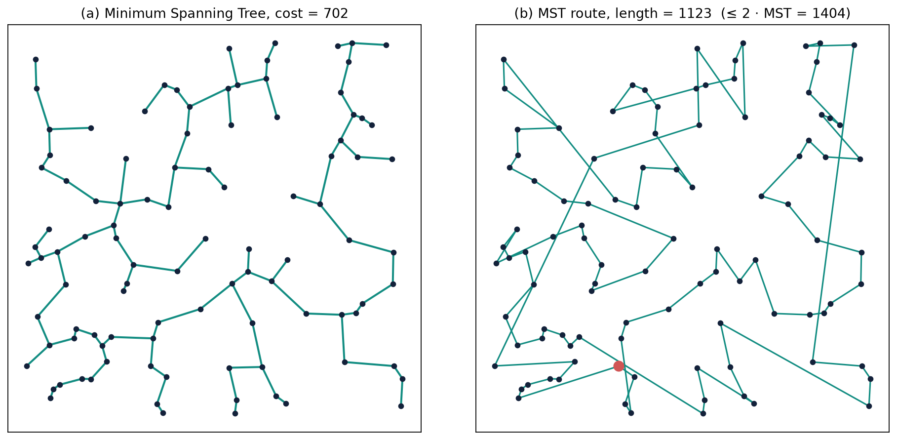

# TSP: Metric MST 2-Approximation

Stage 4 of Problem 15 (Traveling Salesperson Problem): builds a route from a Minimum Spanning Tree and guarantees a result of at most 2 × the optimal route.

---

## Screenshots

<p align="center">
  
</p>

---

## Overview

This is Stage 4 of a five-stage group project on the Traveling Salesperson Problem:

| Stage | Algorithm | Repository |
|---|---|---|
| 1-2 | Brute Force, Nearest Neighbor | [TSP-BruteForce-NearestNeighbor](https://github.com/abbasmammadoff/TSP-BruteForce-NearestNeighbor) |
| 3 | Held-Karp (Bitmask DP) | [TSP-Algorithm-Held-Karp](https://github.com/Supr-giff/TSP-Algorithm-Held-Karp) |
| 4 | Metric MST 2-Approximation | this repository |
| 5 | 2-Opt + Simulated Annealing | |

Exact methods (Brute Force, Held-Karp) become too slow at around 30 cities, and Nearest Neighbor is fast but gives no guarantee. The MST approximation is fast (O(n²)) and its route is never longer than 2 × OPT, as long as the distances satisfy the triangle inequality.

---

## Algorithm

1. Build a Minimum Spanning Tree with Prim's algorithm (array version, O(n²)).
2. Walk around the tree with DFS and write down each city the first time it is visited (preorder).
3. Return to the start city. Skipping already visited cities is called shortcutting.

Why the route is at most 2 × OPT:

- MST ≤ OPT, because removing one edge from the optimal route gives a spanning tree.
- A full walk around the tree uses every edge twice, so it costs 2 × MST.
- Shortcuts never make the route longer (triangle inequality).

So route ≤ 2 × MST ≤ 2 × OPT.

---

## Results

On the 4-city matrix from the problem, the MST costs 45 and the route 0 → 1 → 2 → 3 → 0 has length 95. OPT is 80, so 95 ≤ 2 × OPT = 160.

Experiment 1: 20 random Euclidean maps with 10 cities, compared with the optimum from Brute Force.

| Algorithm | Average cost / OPT | Worst cost / OPT | Guarantee |
|---|---|---|---|
| Nearest Neighbor | 1.08 | 1.29 | none |
| **MST Approximation** | **1.17** | **1.34** | **≤ 2.00** |

Performance measurement (time with `time.perf_counter`, peak memory with `tracemalloc`):

| Cities | Time (s) | Peak memory (KB) |
|---|---|---|
| 100 | 0.0004 | 7.4 |
| 200 | 0.0017 | 18.1 |
| 400 | 0.0068 | 45.4 |
| 800 | 0.0308 | 103.3 |

When the number of cities doubles, the time grows about 4 times (O(n²)), and the extra memory grows linearly (O(n)). Exact times depend on the machine.

---

## Complexity

- **Time:** O(n²) for Prim's algorithm, O(n) for the DFS, O(n²) in total.
- **Space:** O(n) besides the n × n distance matrix.

---

## Project Structure

```
.
├── tsp_stage4_mst.ipynb       # notebook: theory, code, experiments, measurements
├── stage4_mst_100_cities.png  # MST and route for 100 random cities
├── requirements.txt
└── README.md
```

---

## Getting Started

```bash
python -m venv venv
source venv/bin/activate
pip install -r requirements.txt
jupyter notebook tsp_stage4_mst.ipynb
```
